# Встреча сообщества – 5 ноября 2026

## Основная тема

Живая встреча без заранее заданной темы, которая собралась вокруг одного вопроса: что происходит с ролями в разработке, когда AI-инструменты дешевеют, а атаки учащаются. Тамерлан принес кейс руководителя, который после курса по вайбкодингу запустил два продукта за месяц и теперь хочет превратить разработчиков в проектных менеджеров. Михаил подкрепил это слайдами доклада с конференции PMI KZ («PM – владелец ценности», восемь продуктов силами команды из одного-двух человек) и выложил фото слайдов в чат прямо во время встречи. Отдельный большой блок – волна уязвимостей: Стас рассказал, как его команда закрыла уязвимый PHP-сервис за три часа, Михаил – как это сработало в банке, Андрей и Дмитрий спорили, к чему готовиться дальше. Завершилась встреча разговором о выгорании: почему AI заставляет принимать решения чаще нормы, почему ИТ не умеет разрешать конфликты и когда пора уходить из «проклятого» места.

## Участники

- **Андрей** – ведущий: документы как способ сократить разговоры, безопасники не продуктизируют инструменты, механика выгорания через частоту решений
- **Михаил** – разработчик в банке: доклад PMI KZ про PM-билдера, компенсирующие меры, регистрация инцидента как легальный инструмент эскалации
- **Стас** – руководитель разработки: как закрыли уязвимый PHP-сервис за три часа, безопасность на уровне маленьких юнитов, AI как экзоскелет
- **Уалихан** – разработчик, делает OSS-продукт: AI-документация, которую никто не читает, потеря удовольствия от программирования, вопрос про «проклятый отдел»
- **Бекдаулет** – разработчик: риски безопасности вайбкод-продуктов, рост нагрузки на разработчиков, опыт как «набитые шишки»
- **Тамерлан** – первый раз на встрече, принес кейс руководителя-вайбкодера
- **Павел** – критик SDD: спеки превращаются в поток официоза, адвокат дьявола в теме выгорания
- **Дмитрий** – red team и этика публичного обсуждения атак, «шторм надо пережить»

## Подтемы и их суть

### 1. Руководитель-вайбкодер хочет превратить разработчиков в проектных менеджеров

Тамерлан описал крупную казахстанскую компанию со слабой ИТ-частью. Руководитель проекта – не технарь, но сильный менеджер – прошел трехмесячный курс по вайбкодингу, за месяц сделал два продукта и уже внедрил их в бизнес. Теперь он считает, что нужны не разработчики, а люди, разбирающиеся в бизнес-процессах, и хочет перевести фулстеков в проектные менеджеры. Бекдаулет напомнил историю бизнесмена, развернувшего платформу на вайбкоде, которую взломали на следующий день. Андрей сказал, что полгода-год все будет работать, а потом в штате не останется ни одного человека, который знает, где бэкапы и как устроены данные. Он вспомнил дисциплину information management в крупных американских компаниях – людей из бизнеса, которые понимают, откуда идут данные и где формируется ценность, – и ситуацию двухтысячных, когда «эксперт» быстро клепал код и отдавал его разбирать младшим. Убедить тех, кто хочет поверить в волшебную пилюлю, нельзя, но цивилизованно объяснять стоит ради окружающих. И встречный вопрос: почему разработчики должны становиться менеджерами, а не менеджеры и аналитики – вайбкодить самим.

### 2. PM как билдер: доклад PMI KZ и его границы

Михаил видит два направления: выжать больше добавленной стоимости из опытного программиста, который управляет роем агентов, и дать нетехническим специальностям делать то, что раньше было невозможно. Он рассказал о докладе «Изменение роли PM в эпоху AI» на конференции PMI KZ в Алматы и выложил фото слайдов в чат ([71548](https://t.me/teamleads_kz/71548), см. «Параллельно в чате»): восемь продуктов силами команды из одного-двух человек, Telegram-мини-аппка за три дня без разработчика, вывод «PM теперь – владелец ценности». Тогда Михаил выступил скептиком: опытные разработчики уже писали, что перестают понимать сгенерированный код. Но за полгода индустрия перешла к другой концепции – код агента вообще не читают, а строят гардрейлы и проверяют систему как черный ящик: на входе SDD, на выходе внешний контроль.

### 3. SDD и документация, которую никто не читает

Павел пожаловался, что SDD генерирует поток официоза: спеки и планы тяжело читать, но читать их нужно, чтобы понимать, что агент собирается делать. Тамерлан спросил, как SDD вообще попадает в компанию; Павел ответил, что у них этим два года занимался архитектор, сначала для себя, а потом увидел возможность для бизнес-трансформации. Уалихан описал частую историю: системным аналитикам и менеджерам дали AI, и компании получили горы документов, которые никто не прочитает; у них сейчас больше 60 документов о том, как работать, и проблема не решилась, потому что она в управлении и процессах. Андрей сформулировал свою позицию: документ – инструмент сокращения разговоров, способ рассказать пятерым одно и то же. Если транзакции «автор – читатель» не происходит, документ писать не надо. Бекдаулет добавил, что нагрузка на разработчиков с агентами выросла, а не упала: мы поднялись на уровень абстракции выше, но человек, который промптит и проверяет, все равно нужен.

### 4. Волна уязвимостей: закрыться за три часа

Бекдаулет предложил сменить тему: атаки стали ежедневными, после уязвимостей в PHP и Node.js знакомый всю ночь закрывал дыру за дырой. Стас рассказал, как его команда отреагировала на критическую уязвимость в PHP: старый продукт и так планировали закрыть в конце октября, но уязвимость ускорила процесс. Обновиться было невозможно – прыжок с 5.0 на 8, – поэтому закрыли доступ извне к уязвимой части, а на следующий день перенастроили маршруты. Суммарно реакция заняла около трех часов, а мониторинг за 12 часов зафиксировал минимум четыре попытки эксплуатации: «мамкины хакеры» с агентами массово стучат по всем PHP-сервисам. На уязвимость в ядре Linux реакция другая – условия эксплуатации специфические, и до маленького сервиса очередь дойдет нескоро. Михаил добавил уровень сложности: не все умеют штатно выкатывать сервисы, а срочно обновить еще и платформенный слой – гигантская проблема. Ему повезло, что систему заранее перевели на реплики в рамках плана непрерывности, поэтому патч накатывается без простоя.

### 5. Кто отвечает за безопасность: централизованная служба или маленькие юниты

Андрей рассказал о публикации, где AI-лаборатория искала уязвимости по исходному коду и нашла их сотнями, – по сути методику для любого атакующего. Его наблюдение: безопасники решают технические задачи классно, но не продуктизируют инструменты – делают их одноразово и не поддерживают сообщество. Стас возразил: у безопасников не было инструментов, кроме «закрыть все» и «собрать все логи», и централизованная служба не способна защитить организацию – защита возможна только маленькими юнитами, где владелец и разработчик сам отвечает за себя. Бекдаулет пошутил, что безопасники закрывают все, а потом ищут виноватого. Михаил ответил, что «просто закрыть доступ» корпоративно называется компенсирующими мерами, и рассказал, как это было в банке: в тот же вечер собрали владельцев систем, спросили, у кого PHP, все закрыли, а на следующий день запустили сканер по всей инфраструктуре. Андрей предложил оформить это как публичную историю – готовый шаблон реакции для индустрии.

### 6. Пережить шторм и кто может поднять тревогу

Дмитрий заметил, что думать о будущих атаках – значит думать как red team, а это опасная этическая зона для публичного обсуждения. Он пересказал мысль со стрима: год-два «мамкины» вайбкодеры будут выгребать поверхностные уязвимости, и этот шторм надо просто пережить. Он же поднял проблему иерархии: разработчик не контролирует инфраструктуру и может только пингануть админа и эскалировать, а это время. Стас считает, что решать должны технологические менеджеры, которые умеют оценить риск, – и что неквалифицированный менеджмент здесь опасен; в госструктуре ему отвечали «пока не упадет, не зашевелимся». Михаил рассказал, как это устроено у них: по регламенту инцидент может зарегистрировать кто угодно, и это легальный способ перешагнуть через любую иерархию – сначала регистрируешь инцидент критического уровня, потом доказываешь. Итог Стаса: шторм пережить, но подготовить инфраструктуру к быстрой реакции и, пока память свежа, поднять значимость проектов по обновлению старых версий.

### 7. Где вайбкодинг работает, а где нет, и AI как экзоскелет

Вернулись к слайдам Михаила. Стас прочитал истории из доклада: то, что сделали PM, – Telegram-боты и внутренние сервисы, и для такого уровня это прекрасно. Но как только появляется хранение файлов, интеграции и корпоративные требования безопасности, PM с агентами не справятся – и на слайде «Не везде так работает» ([71552](https://t.me/teamleads_kz/71552)) это написано: регулируемые и критические 24/7 системы, высокие требования к безопасности, длинный жизненный цикл. Андрей разделил предпринимателя с техническим пониманием и «чистого» менеджера: первый способен моделировать бизнес-процесс и делать бытовую магию по кусочкам. Бекдаулет сказал, что стоимость разработчика – это его факапы, умноженные на годы. Михаил сравнил это с BTL-активностями в маркетинге: мелочи вне основного бюджета, но исчезает эксклюзивность вендор-лока, когда подрядчик продает за тысячи долларов то, что стоит сотни. Стас процитировал свою рассылку: AI – экзоскелет, он усиливает навыки, но не делает экстраординарным. Михаил возразил: тем, кого засунули в экзоскелет младенцем, грозят атрофированные мышцы.

### 8. Выгорание: решения чаще нормы и конфликты без механизма разрешения

Уалихан признался, что потерял удовольствие от программирования – отчасти из-за AI, который убрал азарт задачи, отчасти из-за людей. Андрей разобрал механику: выгорание – это вынужденно принимать решения чаще нормы; программист раньше принимал пару решений в день и потом долго их кодировал, а AI заставляет принимать мелкие решения постоянно. Цикл, который он описал на себе: неоптимальное решение менеджера – аврал – физическое истощение – злость – болезнь, и замечают это обычно окружающие, а не ты. Отдельно: в ИТ нет механизмов разрешения конфликтов «неостановимой силы и недвижимого камня» – либо разбирайтесь сами, либо побеждает иерархия. Павел выступил адвокатом дьявола: зато фичи пилятся быстрее. Андрей ответил, что это про статус и власть, а не про спрос рынка, а AI дал «чайка-менеджменту» социально одобряемый способ гнать людей.

### 9. «Проклятый отдел» и когда пора уходить

Уалихан спросил Михаила, что сделал бы банк с выгорающим от бессмысленности работы сотрудником, кроме увольнения. Михаил ответил, что в большой организации какой-то процент людей все равно уйдет, но часть переходит в другие юниты и роли – ближе к продукту, к осмысленной работе, иногда просто к другому руководителю, и измерить, что сработало, нельзя. На вопрос про отдел, откуда все уходят через полгода, Михаил сказал, что аномалий в статистике увольнений не видел. Андрей считает, что это проблема маленьких организаций: в большой можно дернуть человека в соседний отдел, а в маленькой каждое движение – трансформация. Его рекомендация: если ты в месте, где ничего не можешь поменять, а ценности компании расходятся с твоими, надо уходить, потому что обман себя ведет к выгоранию. Уалихан возразил, что сменил больше десяти компаний и везде видел одни и те же проблемы; Андрей предположил, что дело в завышенных ожиданиях – человек может развиваться быстрее компании.

## Параллельно в чате

Время – местное (GMT+5), в скобках – примерная минута записи (запись началась около 19:18; сверено по реплике Андрея на 82:44 о вопросе Никиты в чате).

### Слайды доклада PMI KZ, которые выложил Михаил – 20:23 (≈ 65 мин, подтемы 2 и 7)

Фото слайдов доклада «Изменение роли PM в эпоху AI» (Михаил Плотников, IT-директор BI Group, и Таня Плотникова, gro.now; PMI KZ PPS 2026, Алматы, 5 июня 2026). Михаил ссылается на них в записи на 65:17 («на 3 фотке как раз набор этих кейсов»), Стас разбирает их на 72:11.

| Слайд | Сообщение | Фото |
|-------|-----------|------|
| Титул: «Изменение роли PM в эпоху AI» | [71548](https://t.me/teamleads_kz/71548) | 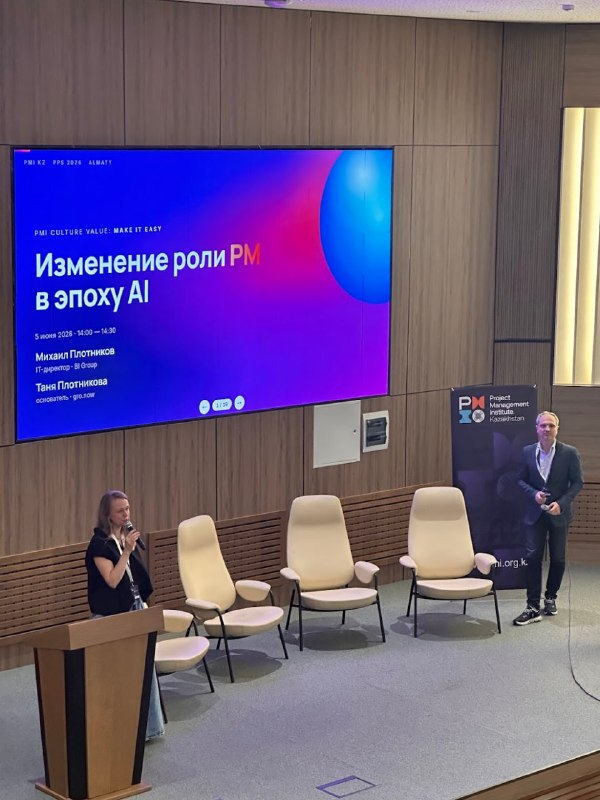 |
| «Кто говорит»: два спикера | [71550](https://t.me/teamleads_kz/71550) | 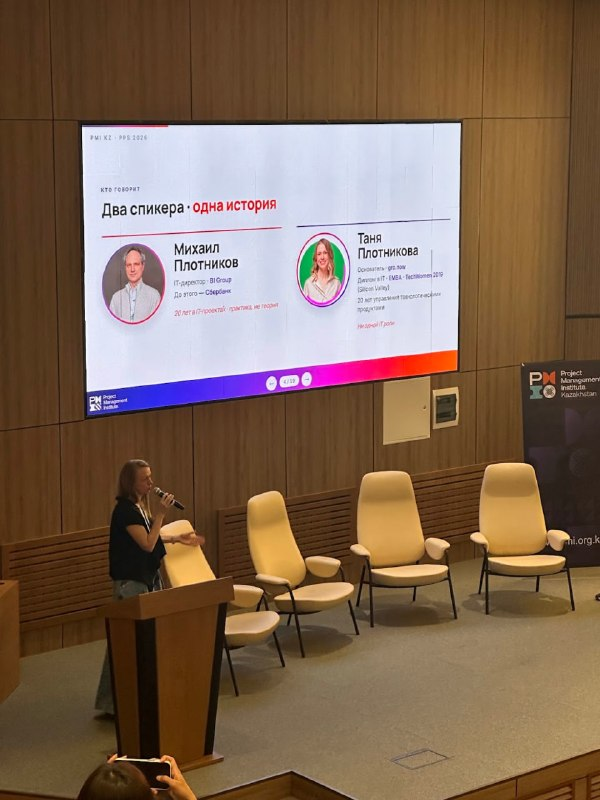 |
| «Восемь продуктов · команда 1–2 человека» | [71551](https://t.me/teamleads_kz/71551) | 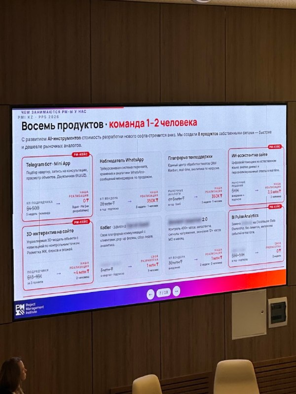 |
| «Не везде так работает» – где работает и где нет | [71552](https://t.me/teamleads_kz/71552) | 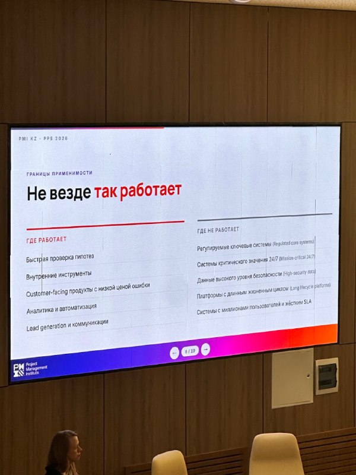 |
| Кейс 1: чат-платформа – 35 млн ₸ у вендора против 1 млн ₸ и недели силами PM | [71553](https://t.me/teamleads_kz/71553) | 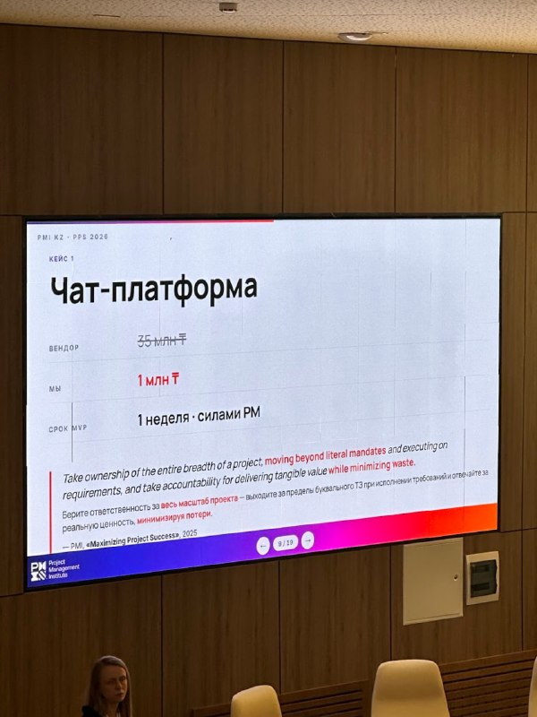 |
| Кейс 2: Telegram-мини-аппка – 3 дня, PM не разработчик, 0 ₸ | [71554](https://t.me/teamleads_kz/71554) | 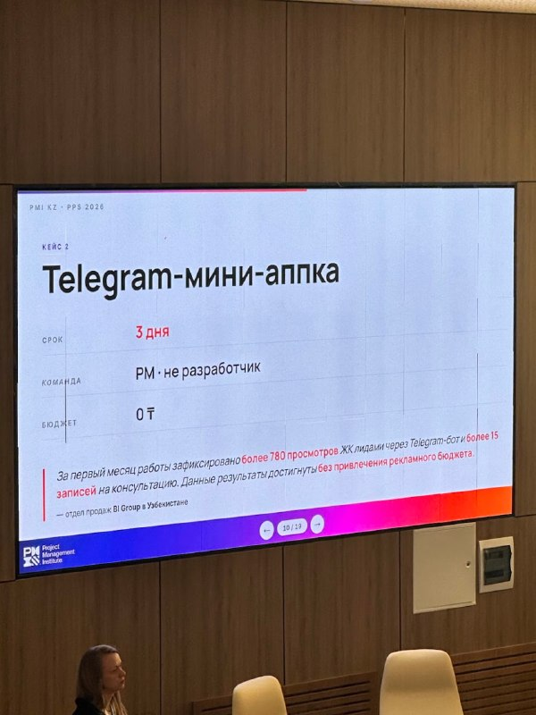 |
| «PM всегда был T-shaped дирижером» | [71555](https://t.me/teamleads_kz/71555) | 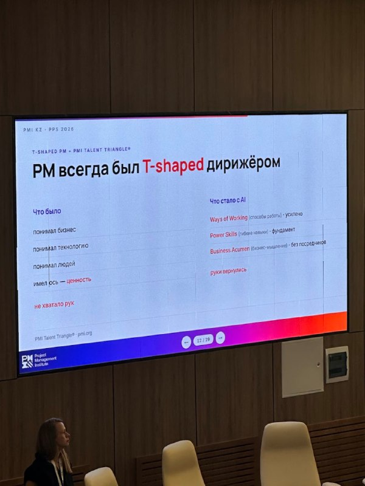 |
| «Исследователь был человеком процесса. С AI – человеком результата» | [71556](https://t.me/teamleads_kz/71556) | 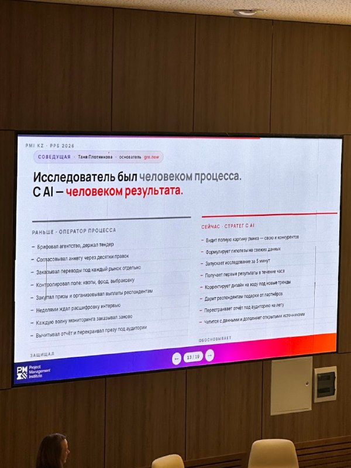 |
| «Пять вещей, которые остаются за человеком» | [71557](https://t.me/teamleads_kz/71557) | 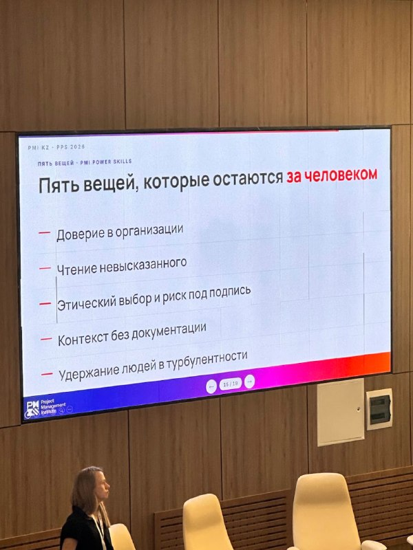 |
| «PM теперь – владелец ценности» | [71558](https://t.me/teamleads_kz/71558) | 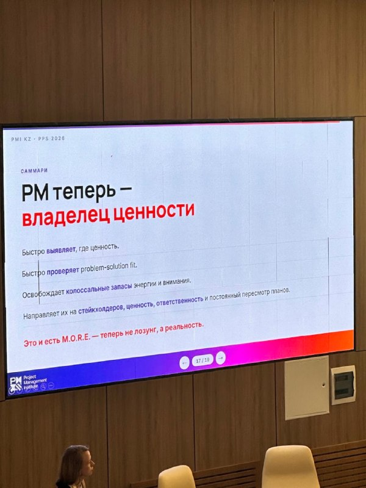 |
| «Ключевые выводы» – с подписью «вот та история, про которую я упоминал» | [71559](https://t.me/teamleads_kz/71559) | 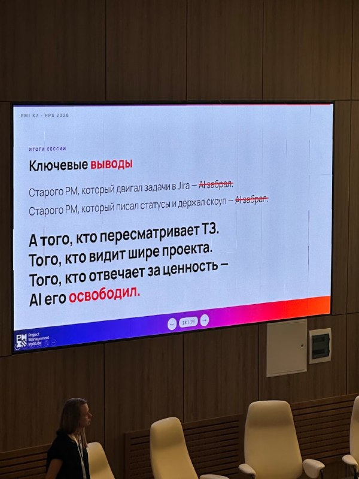 |
| «Спасибо!» – контакты спикеров | [71560](https://t.me/teamleads_kz/71560) | 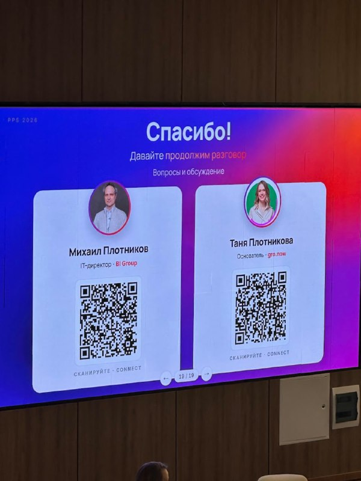 |

### sshhole.com и масштаб угрозы – 20:46–21:09 (≈ 88–111 мин, подтемы 4–6)

Пока на звонке обсуждали волну уязвимостей, в чате разбирали ссылку на sshhole.com:

- [71568](https://t.me/teamleads_kz/71568) – LSTR Unit выкладывает ссылку на sshhole.com
- [71571](https://t.me/teamleads_kz/71571), [71572](https://t.me/teamleads_kz/71572) – Стас: звучит страшно, но не очень масштабно – образы должны торчать наружу, да еще и с открытым SSH-портом
- [71573](https://t.me/teamleads_kz/71573), [71574](https://t.me/teamleads_kz/71574) – Андрей Звёздочка: достаточно уязвимости в каком-нибудь PHP, куда можно загрузить скрипт, а дальше через внутреннюю сеть Docker взломают все; и это не только Alpine, но и OpenWrt, который стоит на миллионах роутеров
- [71575](https://t.me/teamleads_kz/71575), [71576](https://t.me/teamleads_kz/71576) – LSTR Unit: речь о мелких машинах с SSH наружу, но OpenWrt тоже смущает
- [71578](https://t.me/teamleads_kz/71578)–[71580](https://t.me/teamleads_kz/71580) – Стас: про роутеры не думал – это частные инсталляции и мелкие конторы; а сценарий с PHP – уже комбинированная атака

### Организационное

- [71509](https://t.me/teamleads_kz/71509) – 19:15, Никита Баев создал комнату Google Meet для встречи («могу проспонсировать сегодня»), сам присоединиться не смог
- [71565](https://t.me/teamleads_kz/71565)–[71570](https://t.me/teamleads_kz/71570) – 20:40 (82:44 в записи), Никита спрашивает, сидим ли еще; Андрей: «6 человек, если можешь, заходи»

## Различные мнения

| Вопрос | Андрей | Стас | Михаил | Уалихан |
|--------|--------|------|--------|---------|
| Можно ли заменить разработчиков вайбкодящими менеджерами? | Полгода все будет работать, потом никто не знает, где бэкапы и как устроены данные | Для ботов и внутренних сервисов – да, для продуктов с безопасностью и интеграциями – нет | Да для мелочей вне основного бюджета: исчезает вендор-лок, но критичные системы так не строят | – |
| Нужна ли документация, которую генерирует AI? | Только если есть транзакция «автор – читатель», иначе писать не надо | – | – | Компании получили горы документов, которые никто не читает; проблема в управлении |
| Кто должен отвечать за безопасность? | Безопасники сильны технически, но не продуктизируют инструменты | Централизованная служба не способна защитить – только маленькие юниты и владельцы | Централизованная реакция работает: собрали владельцев в тот же вечер, на следующий день – сканер | – |
| Как реагировать на волну уязвимостей? | Обновлять все и сразу по максимуму | Оценить риск: PHP закрыли за три часа, Linux – по плану; готовить инфраструктуру к быстрой реакции | Иметь реплики и регламент, по которому инцидент может зарегистрировать кто угодно | – |
| Что делать, если выгораешь на месте, где ничего не изменить? | Уходить: обман себя ведет к выгоранию | – | В большой организации можно сменить юнит или роль | Сменил много компаний и везде одно и то же – ищет проблему в себе |

## Основные выводы

### Вайбкодинг убирает вендор-лок на мелочах, но не заменяет инженерию
Боты, внутренние инструменты и проверка гипотез – территория, где менеджер с агентом действительно экономит деньги и время, и это меняет переговоры с подрядчиками. Регулируемые, критичные и долгоживущие системы туда не попадают: через полгода в них нужен человек, который знает, где данные, бэкапы и как это все устроено. Сам доклад, на который ссылались, честно проводит эту границу.

### Документ нужен, только если его прочитают
Документация – способ сократить разговоры, а не самоцель. AI сделал генерацию документов бесплатной и этим обесценил ее: компании тонут в спеках и регламентах, которые никто не открывает. Мерилом остается транзакция «автор – читатель», а для SDD – вопрос, сколько официоза команда реально готова читать.

### Готовность к уязвимостям – это скорость реакции, а не идеальная защита
Публичная простая уязвимость эксплуатируется массово в течение часов, поэтому решает умение быстро закрыться компенсирующей мерой и быстро обновиться. Сложная уязвимость со специфическими условиями может подождать плана. Инфраструктура с репликами и регламентом, по которому любой может зарегистрировать критический инцидент, превращает аврал в рутину.

### Ответственность за безопасность не делегируется полностью
Централизованная служба реагирует на прошлое, владельцы систем – на настоящее. Работает сочетание: служба быстро собирает владельцев и дает сканер, а владелец и разработчик сами отвечают за свой участок. Слабое место – неквалифицированный менеджмент, который не умеет оценить риск и ждет, пока упадет.

### AI усиливает навыки, но может их атрофировать
Экзоскелет делает сильного человека сильнее, но не создает идей и опыта. Стоимость инженера – это набитые шишки, умноженные на годы, а тот, кто начинает работать сразу с агентами, рискует этот опыт так и не набрать.

### Выгорание растет из частоты решений и неразрешимых конфликтов
AI ускорил работу и одновременно заставил принимать мелкие решения постоянно – это и есть стресс. Добавьте конфликты, для которых в ИТ нет механизма, кроме иерархии, и менеджеров, которым AI дал повод гнать быстрее. Если ценности места расходятся с твоими и ничего изменить нельзя, честнее уйти, но перед этим стоит проверить, не перерос ли ты компанию.

## Вопросы для дальнейшего обсуждения

- Как провести в компании границу «здесь менеджерам можно вайбкодить, здесь нельзя» и кто отвечает за то, что они построили
- Почему аналитики и менеджеры не хотят вайбкодить сами, а разработчиков хотят превратить в менеджеров
- SDD без потока официоза: какой объем спек и планов команда реально готова читать и поддерживать
- Регистрация инцидента как легальный инструмент эскалации: как внедрить такой регламент в компании без зрелых процессов
- Как планировать обновление старых версий платформы, пока после волны уязвимостей у бизнеса свежа память
- Механизмы разрешения конфликтов в ИТ-командах, кроме «победит иерархия»
- Как растить джунов, чтобы AI-экзоскелет не атрофировал навыки
